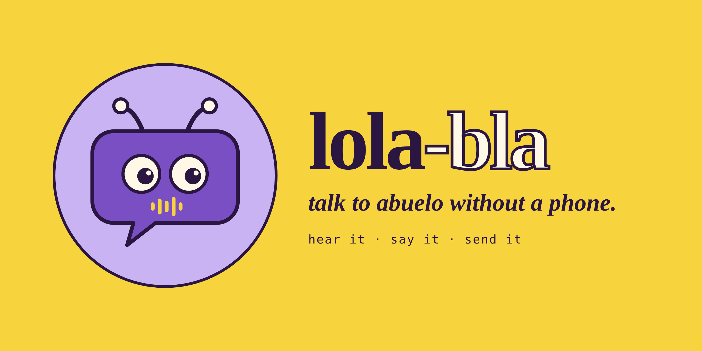

# Lola-Bla



An app for the Reachy Mini robot that lets a young child hear and send voice messages to family abroad — safely, and entirely on her own.

## Why I built this

I grew up able to just pick up the phone and call my grandparents whenever I wanted to. As a foreigner raising my daughter in Germany, far from most of our family, I wanted her to have that same simple, direct connection — without needing to ask me to unlock my phone and dial every single time.

At the same time, she's a small child, and I wasn't willing to hand her open access to a messaging app or a phone. Lola-Bla is my answer to both: a robot she can just talk to, that reads her messages aloud and helps her record replies, while every piece of it is built so that only I can ever see or touch the sensitive parts — her contacts, her messages, who she's allowed to talk to.

This project was also my capstone during maternity leave — a hands-on way to actually understand, by building one myself, what a "multi-agent system" really means in practice, beyond the buzzword. (Worth being upfront: this specific app didn't *need* two agents — a single agent with more tools would have worked just as well, and been simpler. I built it with two deliberately, as a genuine multi-agent exercise, not because the task demanded it.)

## Built with Claude

I built this together with [Claude](https://claude.ai), Anthropic's AI assistant, and part of the point was to find out how far I could get working that way.

**What I did.** I defined what Lola-Bla has to do and what it must never do: the user stories, the acceptance criteria and the safety and privacy rules. I required a specification for every step and an architecture before any code, and I approved each one before it was built. I questioned Claude's designs whenever they crossed one of my lines, ran everything on the robot with a real phone and a real browser, and decided what counted as done.

**What Claude did.** Claude wrote the specifications and the design options for me to approve, and then the code, the tests and the documentation. It explained the options and checked its own work against the output I pasted back from the robot. I did not write the code, and I did not learn to write specifications myself: I asked for them, and I kept asking for them.

**Where I pushed back, and the design changed**

- Claude's first sketches blurred the line between the robot and the cloud, and leaned towards the cloud. I insisted that the tools, the data and every recording of a message stay on the robot. Today the cloud AI hears the live conversation and is told only names, counts and times about the messages. The recordings, the contacts and the database never leave the Pi.
- I questioned why we still needed local speech recognition and speech synthesis once an AI could do both. That led to building on Pollen Robotics' real-time conversation app, which answers quickly enough for a small child. The local version took 15 to 30 seconds per turn.
- I proposed building child safety into the personality of the one agent that talks to the child, instead of a second checking agent, which cannot sit in the middle of a real-time stream.
- I asked for an audit trail, a password-protected console with the password recovery handled on the Pi, and the docs updated in the same step as each piece of code, instead of afterwards.

**How I steered the work** (these were my instructions from the start, not lessons I picked up along the way)

- **Specification first, then design, then code.** I told Claude I wanted the user stories and acceptance criteria agreed before anything was built, and an architecture before the implementation. I kept to this even though it takes much longer.
- **Safety by design, not by accident.** I asked for safety to be part of the structure from the start: data and secrets live outside the repo so they cannot be committed by accident, a scan runs before every push, and the cloud AI only sees what it needs.
- **Small steps, each verified.** Every piece is tested on its own (offline tests with fakes, then the real thing) before the next one is built on top, and I check the output of every step.
- **The documentation moves with the code.** At one point the docs had fallen behind, because Claude kept putting them off until a later commit. I told it to update the docs in the same step as the code, and it has worked that way since.

**What I observed along the way**

- **The assistant makes mistakes, and the process catches them.** A security header made the console refuse every sign-in (found in a real browser, now pinned by a test). Asking for the group "Test" also played "Another test" (found in a live run). Messages were once marked as played when playback had failed. Nothing counted as done until it ran.
- **It only knows what I show it.** Claude cannot see my screen or my robot. Everything it knew about what actually happened came from the output I pasted back, so those pastes were part of the engineering.

## What it does

- **Reads messages aloud** — Reachy checks a small set of approved family Signal groups, announces who a message is from and when it arrived, and plays it.
- **Records and sends replies** — a clear start cue, records until she stops talking, a clear "done" cue, then lets her hear it back, send it, or try again before anything is sent.
- **Talks naturally** — real, warm, back-and-forth conversation, not a rigid command list. Responses are quick (typically under 2 seconds) and age-appropriate for a young child, with built-in guardrails to keep the conversation safe and always ready to point her to a parent for anything outside its scope.

## Architecture, and why it's safe

Two things happen in two different places, deliberately kept apart:

- **The conversation itself** — hearing the child, understanding her, speaking back — happens through a real-time cloud AI service. This is what makes it feel natural and fast.
- **Everything sensitive — the actual message content, contacts, who's allowed to talk to whom, and the message audio itself — never leaves the robot.** Recording, storage, and sending all happen locally. The cloud service is only ever told the *outcome* of an action ("message sent" / "here are 2 new messages from Grandma"), and never the message audio, phone numbers or database access.

Concretely, the robot uses **two separate AI agents**: one handles the live conversation and personality; the other, invoked only internally, decides *what* the child is asking for and hands that decision to plain, local code that actually does it — record, check, or send. The two never talk to each other directly, and neither one is ever handed more information than it strictly needs to do its one job.

On top of that: only the family administrator (me) can access the underlying data or logs, no matter where they're stored; every access to sensitive data is recorded in an audit trail I can review; and being a member of a family Signal group isn't enough on its own to be trusted — every person has to be explicitly approved before their messages count.

## Privacy: what leaves the robot (read this before you build one)

- **The live conversation** runs on Pollen's hosted real-time voice server by default. While the app is running, everything the microphone hears goes there, including speech that is not meant for the robot, except while a message is being recorded. I found no published statement about how long that service keeps audio, whether it trains on it, or whether people review it.
- **The messaging assistant** sends only a short task text (sometimes a group or sender name) to Hugging Face's Inference service. Hugging Face says it does not store it or train on it, but the provider behind it is not pinned, so that provider's policy is unknown.
- **Message recordings, contacts and the database** never leave the Pi.
- I know about this and have accepted it for now. If you build this for a child, decide for yourself. The options (asking the providers in writing, or running the voice engine at home) and the sources are in [docs/reference/cloud-privacy-check.md](docs/reference/cloud-privacy-check.md).

## Status

- ✅ Reading messages, and recording and sending replies
- ✅ Natural conversation, performance, and safety guardrails
- ✅ The configuration console: sign in, change password, link and unlink Signal, approve groups and contacts, read the logs, start Lola-Bla when the robot wakes up
- ✅ Runs as a Reachy Mini app (`lola_bla`): a light page inside Reachy Mini Control, the full console in your browser
- ✅ Say "sleep" (in English, Spanish or German): Lola asks first, then goes to sleep; an antenna touch wakes her and starts the app
- 🔨 Before publishing: a full security and privacy re-check, and the docs for people who only want to use it

## Running it

Needs a Reachy Mini Wireless with its daemon running, a Signal account on your phone, Docker, `sox`, `ffmpeg`, `sqlite3` and a Hugging Face account. The install script has been tested in a scratch folder except for its Python-environment step, so treat a first install as a dry run.

### Install

```bash
git clone https://github.com/betiana688/lola-bla.git
cd lola-bla
./app/install.sh
```

The script clones Pollen's app at the commit we run, applies our two-line patch, links our files into it (one copy of each, in this repo), creates the database and sets up the Python environment.

### Then, by hand

1. Start the Signal API so that it listens on this machine only. We run version 0.100 (see `/v1/about`); pin the image to a version once you know which one works for you.
   ```bash
   docker run -d --name signal-api --restart=always -p 127.0.0.1:8080:8080 -v $HOME/.local/share/signal-api:/home/.local/share/signal-cli -e MODE=native bbernhard/signal-cli-rest-api
   ```
2. From the repo folder, create the console user and its certificate, then start the console, open `https://reachy-mini.local:9443/`, sign in, and link your Signal account on its Signal page (scan the QR code in Signal, under Linked devices):
   ```bash
   source ~/lola-bla-agents/venv/bin/activate
   python3 console/manage.py create-user
   python3 console/manage.py make-cert
   python3 console/run.py   # or keep it running as a service: ./console/install_service.sh (add --boot on to start it at boot)
   ```
3. Give the messaging assistant its own Hugging Face token, in a file only you can read, and log in to Hugging Face for the live conversation:
   ```bash
   read -rs -p "Token: " T; echo
   ( umask 177; printf '%s' "$T" > ~/lola-bla-agents/reachy_mini_conversation_app/local_data/hf_token ); unset T
   hf auth login
   ```
4. Add your approved groups and contacts on the console's Groups and Contacts pages. (The same can be done with `sqlite3`: see [docs/reference/database.md](docs/reference/database.md).)
5. Start the app from the command line. As the Reachy Mini app `lola_bla` you can instead start it in Reachy Mini Control, or let an antenna touch start it (see [app/README.md](app/README.md)):
   ```bash
   cd ~/lola-bla-agents/reachy_mini_conversation_app
   REACHY_MINI_CUSTOM_PROFILE=lola reachy-mini-conversation-app --no-camera
   ```

## Known limitations

- The console cannot yet unlink Signal, manage groups and contacts, or show logs: approvals are still managed by hand
- The messaging assistant needs Hugging Face credits; without them a simple local fallback keeps messaging working
- Not yet published: it runs as a Reachy Mini app (`lola_bla`) but is installed from this repo, not from the app store (see docs/architecture/publishing.md)
- The live conversation's cloud service has no published data-retention statement that I could find (see the privacy section above)
- Fixed maximum recording length (30s), with automatic stop after ~5 seconds of silence
- Two small local patches to the underlying conversation engine are kept as a patch file (`app/patches`) and are not yet upstreamed

## Documentation

Everything else lives in [docs/](docs/README.md): user stories, architecture and diagrams, data model, development plan, SBOM, backlog and command references.

## Repository layout

```
app/              Conversation app code (messaging tool, agent, executor, schema)
console/          Configuration console (Story 3)
prototype/        First, fully local version (superseded, kept for reference)
profiles/lola/    The conversational agent's personality and safety profile
docs/             Requirements, architecture, references
docs/brand/       Logo, app icon, colours, fonts and posters
```

## License

TBD.
