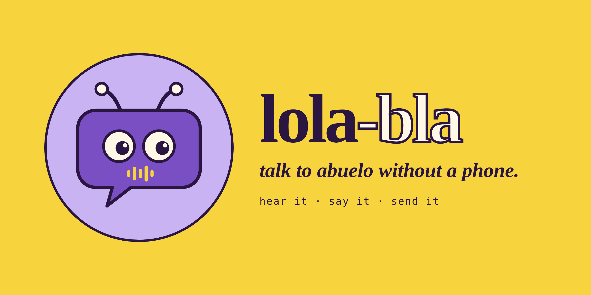

# Lola-Bla documentation

**talk to abuelo without a phone.** Lola-Bla lets a young child hear and answer Signal voice messages from family far away, on a Reachy Mini robot. The parent decides who can talk to her.

## Two ways in

### I have a Reachy Mini and want to use it

- [What it does, what you need, and how to install it](../README.md#running-it)
- [What leaves the robot, in plain words](../README.md#privacy-what-leaves-the-robot-read-this-before-you-build-one)
- [Security review](reference/security-review.md): what is reachable, what is protected, what is accepted
- [Cloud privacy check](reference/cloud-privacy-check.md): what the two cloud services publish about data
- [The settings console](architecture/console.md): sign in, link Signal, approve groups and contacts, read the logs
- [User stories](requirements/user-stories.md): what Lola does and must never do

### I want to understand how it is built

- [Overview](architecture/overview.md): system, two agents, mic handoff, privacy rules, decisions
- [Conversation app](architecture/conversation-app.md): check messages, Signal sync, states, sleep, module diagrams
- [Console redesign: two doors](architecture/console-redesign.md): the light page in Control and the full console in a browser
- [Data model](architecture/data-model.md)
- [Publishing as a Reachy Mini app](architecture/publishing.md): how apps work, what differs today, switching to another app
- [How the Pi, the repo and GitHub connect](architecture/pi-repo-connection.md)
- [Development plan](development-plan.md): purpose, stories, how it was built, status
- [Backlog](backlog.md) and [SBOM](sbom.md)

## Reference

- [Database](reference/database.md): `sqlite3` commands for groups, contacts, messages, logs
- [signal-cli-rest-api](reference/signal-cli-rest-api.md): endpoints for linking, receiving, sending, and what our own tests showed
- [Emotions mapping](requirements/emotions-mapping.md): Reachy's reactions per conversation state

## Brand and personality

- [Brand](brand/README.md): the mark, app icon, colours, type, voice and ready-made posters
- [profiles/lola/profile.md](../profiles/lola/profile.md): personality, safety rules, voice, enabled tools
