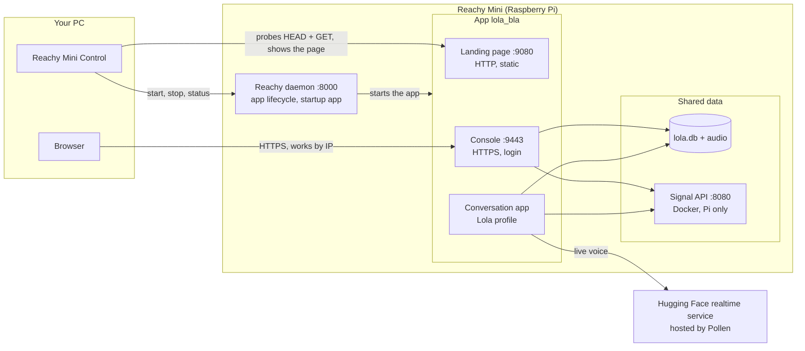
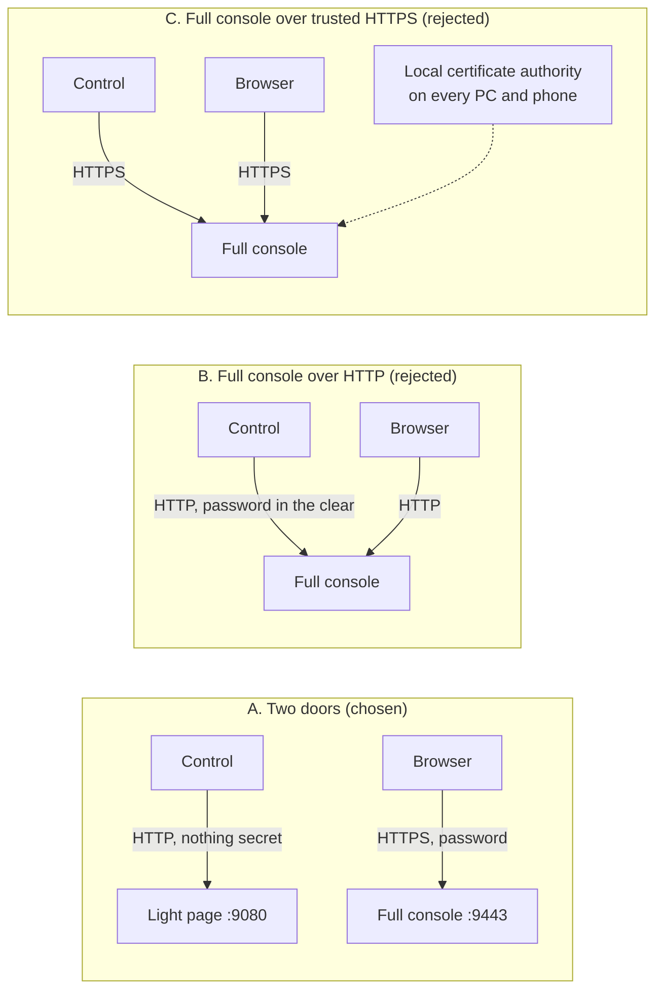
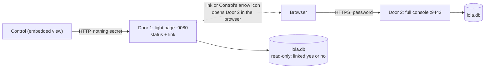

# Console redesign: two doors (decision 2026-11-06)

Status: decided by the author, spec below, nothing built yet. Written after the first attempt to open the console from Reachy Mini Control failed. See also [console.md](console.md) (the console as built) and [reachy-app-poc.md](reachy-app-poc.md) (the experiments behind the facts here).

## Decision

**No weakening of security to make the console run inside Control.** The console keeps HTTPS and its login. Two doors instead:

1. **Door 1, inside Reachy Mini Control:** a light page over plain HTTP that shows the app's status and a link to launch the full console in the browser. Nothing secret, no login, no actions.
2. **Door 2, in a browser:** the full console, exactly as today (HTTPS, self-signed certificate, login, all pages).

Both are served by the `lola_bla` app. The light page replaces today's landing page. The styling stays the Lola-Bla brand ([brand](../brand/README.md)).

## Requirements

| | |
|---|---|
| R-A | Something of the console is visible inside Reachy Mini Control, with a way to launch the full console in a browser |
| R-B | The full console runs standalone in a browser, as today |
| R-C | No password, session or action ever travels over plain HTTP |
| R-D | The published app works the same for anyone who installs it (no certificate authority to install, nothing specific to this home network) |

## How it is built today

## Facts behind the decision

| Fact | Evidence | Status |
|---|---|---|
| Control stops an app whose web address it cannot reach. A self-signed HTTPS address counts as unreachable | Same app, only the address changed: HTTPS self-signed stopped after 60 s, plain HTTP stayed up 4 min. Pollen's desktop app issue #272 | proven |
| So the address Control embeds must be plain HTTP, or HTTPS with a certificate the PC trusts | follows from the line above | proven |
| The console forbids being shown inside another page (`frame-ancestors 'none'`, `X-Frame-Options: DENY`) | response headers on `/login`. Deliberate, kept | seen |
| `reachy-mini.local` reaches the PC over IPv6, the console listens on IPv4 only | `https://<robot IP>:9443/` works, the name does not | confirmed |
| Control embeds the page at `custom_app_url` in its panel | screenshot of the panel showing the landing page | observed |
| A link with `target="_blank"` inside that panel did nothing | tested 2026-11-06 | observed |
| Control's arrow icon opens the page in the system browser | tested 2026-11-06 (the page opened in Chrome) | observed |
| Control's web origin (Windows build, Control 0.9.38) | request log of the landing page, 2026-11-06: `Referer: http://tauri.localhost/` on Control's requests, `Origin: http://tauri.localhost` on one fetch | observed |
| Control shows the page in an iframe | its page request carries `Referer: http://tauri.localhost/` and no `Origin` (inferred, not proven) | inferred |
| No `Sec-Fetch-*` headers arrive over plain HTTP, so the server cannot tell iframe from top-level that way | none in the log | observed |
| The arrow icon opens the page top-level in the system default browser (Edge here), with no `Referer` | request log, 2026-11-06 | observed |
| Clicking the link inside the panel does nothing, with or without `target="_blank"` | tested twice, 2026-11-06 | observed |
| The window the arrow icon opens is drawn by Control itself, with no address bar and no tabs: a link clicked there does nothing either; typing the address in a real browser works | tester report, 2026-11-06 | observed |

Pollen's documentation (SDK, "Building and publishing apps") says: set `custom_app_url` for a settings page, the example is plain HTTP on port 8042, and "Reachy Mini Control opens this UI as soon as the server answers". It does not say whether the page is embedded or opened in a window, whether HTTPS is allowed, or anything about frame headers.

## Options that were weighed

B puts the password and the session cookie on plain HTTP: rejected (R-C). C needs a certificate authority installed on every device: rejected (R-D).

## Target

## Spec: Door 1, the light page

Replaces `landing.py`. Same port (9080, `LOLA_LANDING_PORT`) and the same address in `custom_app_url`.

**Must keep (found in the experiments)**
- Answers `HEAD` and `GET` with 200 and never redirects, because Control probes the address and stops the app when it fails.
- No `X-Frame-Options` and no `frame-ancestors` restriction on this page, because it is meant to be shown inside Control. It holds nothing worth clicking over.

**Shows (confirmed by the author, 2026-11-06)**
- "Lola-Bla is running", with a short description of the app: what it does, in a sentence or two.
- Whether Signal is linked: yes or no. Never the phone number.
- A prominent button "Open the full console", and the address as plain text beneath it, so it can be typed or copied.

**Never shows:** any user information: names, phone numbers, messages, audio, log text, or anything from `audit_log`.

**The link to the full console**
- Built from the address the viewer used (the robot's IP as Control reaches it), validated, with `reachy-mini.local` as fallback. This is already done in today's landing page and stays.
- Opens in a new tab (`target="_blank"`, `rel="noopener noreferrer"`).
- Inside Control's panel the link does nothing (observed). So the page also shows the address as text and says to use Control's arrow icon, which opens the page in the browser, where the link works. A copy button is optional and only added if it works inside the panel.
- Fallback to learn: whether any link form opens the system browser from inside the panel. To test once, not to loop.

**Two variants of the same page (decided from the step 2 log)**
- Embedded in Control (the request carries `Referer: http://tauri.localhost/`, the origin Control uses on Windows): no dead button. Status, description, and a clear instruction: "Open the full console: click the arrow icon at the top right of this panel", with the address as text.
- Opened in the browser (no `Referer`): the same status and a working button "Open the full console", with the address as text.
- Anything else: the button and the instruction together.
- Only the display changes. The `Referer` is never trusted for anything else.
- Changed 2026-11-06: the window the arrow icon opens is a plain window drawn by Control, where links do nothing. The browser variant therefore also shows the address with a copy button. It is the page's only script: it selects and copies the visible address, it has no network access, and the page's `Content-Security-Policy` allows exactly that script by its hash.
- The link and the address come from the address the page was reached on (the connection), not from the `Host` header; the header is only a fallback.
- No automatic redirect to the console, ever: Control probes this address, and a redirect to a self-signed HTTPS page would make the probe fail and stop the app.

**Security rules for Door 1**
- `GET` and `HEAD` only. No forms, no cookies, no sessions, no script that sends data.
- Data comes from a read-only database connection with fixed queries (one boolean: Signal linked yes or no). A failure shows "unknown" and never an error text. Nothing is written.
- Same hardening headers as today: `Cache-Control: no-store`, `nosniff`, `Referrer-Policy: no-referrer`, a strict Content Security Policy.
- Host header validated before it is used (already done).
- The page is reachable only on the home network and only while the app runs. Confirmed again in the privacy recheck.

**Styling**
- Lola-Bla brand: the tokens in `docs/brand/tokens.css` (banana, lila, violeta, berenjena, crema), Fraunces for titles, DM Mono for text, light and dark theme following the device.
- Fonts served from the app itself, so a page load never contacts a third party (the CSP allows `font-src 'self'` and nothing else).
- A test checks contrast of every text and background pair in both themes, like `tests/test_style.py` for the console.

## Spec: Door 2, the full console

Unchanged. HTTPS with the self-signed certificate, login, lockout, CSRF, frame protection, all pages. Open: IPv6, so that `https://reachy-mini.local:9443/` works too (needs a router check first, see the backlog).

## Build order (each step verified before the next)

1. Spec approved (this page).
2. Log what Control sends with its requests (`Referer`, `Sec-Fetch-Dest`) for the first requests, to learn its origin and whether the panel is an iframe. Built 2026-11-06 (`landing.py` logs `Origin`, `Referer`, `Sec-Fetch-*` and `User-Agent` of the first 15 requests, never cookies or credentials). Done: the result is in the facts table above.
3. Light page: layout and styling with static content, tests. DONE (brand look, two variants by Referer, fonts and mark served by the page itself, contrast tests).
4. Light page: status data (read-only), tests. DONE (`signal_status()`: read-only connection, one fixed query on the account status, a yes or no, never the number; hidden when unreadable).
5. Hand-off: DONE. A link does not work in either Control view, so the address with a one-click copy button is the way in. The button stays for real browsers.
6. Update this page and the README of the app.

## Open questions

- Whether any link form opens the system browser from inside Control's panel.
- IPv6 for the console, and the FRITZ!Box setting for inbound IPv6.
