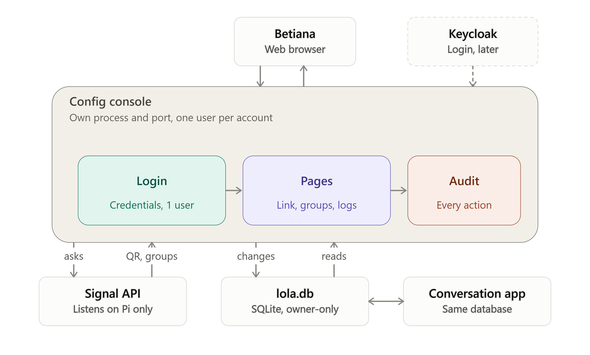
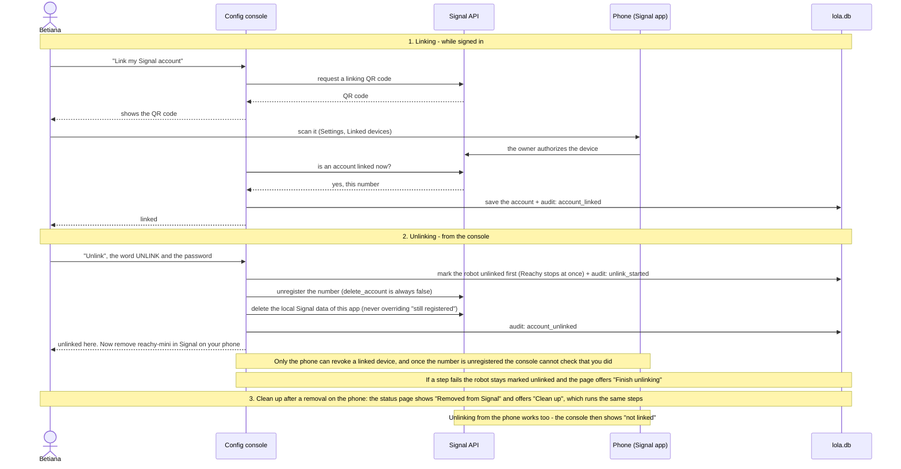
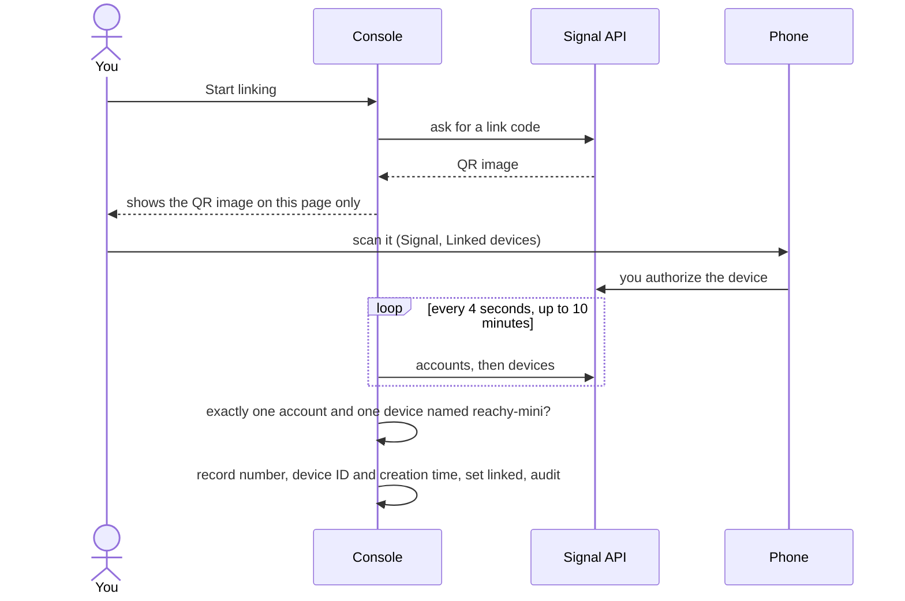

# Config console (Story 3)

- Own process, served over HTTPS (self-signed certificate) on port 9443, reachable on the home network, one user per account.
- **Login**: credentials, one user. Keycloak maybe later.
- **Pages**: sign in, change password, Signal account (link and unlink), then groups, contacts and logs.
- **Audit**: every action is written to `audit_log`.
- Reads and changes `lola.db`, the same database the conversation app uses. See [data-model.md](data-model.md).
- Talks to the Signal API, which listens on the Pi only.

## Linking and unlinking Signal

## Login, password change and recovery

Recovery: a reset command on the Pi for now; a one-time code via Signal later (not built yet).

## As built (updated 2026-11-04)

This section describes the console as built, step by step. The sections above are the design.

### Pages and commands

| Where | What |
|---|---|
| `/login`, `/logout` | Sign in and out. Events are audited as `console:<username>` or `console:anonymous`; the typed username is never stored |
| `/` | Home: counts and links |
| `/password` | Change password: current password, then the new one twice |
| `/signal` | Signal account: status, linking and unlinking |
| `manage.py create-user`, `reset-password`, `status`, `make-cert` | Run on the Pi |
| `run.py` | Starts the console over HTTPS on port 9443 (`LOLA_CONSOLE_PORT`) |

### Security as built

- HTTPS only, with a self-signed certificate valid for `reachy-mini.local`, localhost and the Pi's addresses. The key stays in `~/.config/lola-bla/tls`, outside the repo.
- Passwords: scrypt hashes. The minimum is 5 characters on purpose; the username may not appear inside; a few easy guesses are refused.
- Lockout: 5 wrong passwords in a row lock sign-in for 15 minutes. Wrong current passwords on the change-password page count too. A reset on the Pi clears it.
- Sessions: signed cookies (HttpOnly, Secure, SameSite=Strict), 8 hours. Every request re-checks the database, and a password change ends every earlier session.
- Forms: a CSRF token and an Origin check on every POST. `Referrer-Policy: same-origin`, because `no-referrer` makes browsers send `Origin: null` and would lock everyone out. No HSTS, because it would stop the browser accepting the self-signed certificate.
- The console answers only to its own host names, and pages are never cached.

### Signal page (step 8a)

The status comes from the Signal API's own answers (`/v1/accounts` and `/v1/devices/<number>`), never from the database alone. The number is shown masked, and loading the page never changes data. If the Signal API is busy (it does one operation at a time, for example during a long receive), the page can take up to a minute and may say "Cannot tell".

| State | Meaning |
|---|---|
| Linked | Our number is registered and our recorded device (ID and creation time) is on its device list |
| Not linked | The API has no account, or says the number is not registered. Linking is offered only when the API has no account at all |
| Removed from Signal | The number is registered but our device is no longer on its list (removed in Signal on the phone) |
| A different account | The API has an account that is not the one in the database |
| Cannot tell | The API did not answer, or answered something unexpected |
| Unlinking not finished | The robot is marked unlinked here, but the Signal API still has the account (an earlier unlink stopped partway) |

A different account than the one in the database is refused: nothing is recorded, and the page says to remove the new device in Signal on the phone.

The robot's device ID is per Signal account (2 for the live robot, 3 for the throwaway test device on the same account), so the console records the ID together with the creation time and never relies on the device name.

### Unlinking (step 8b)

One form on the Signal page, with three labels for the same action: **Unlink** (linked), **Clean up** (the device was removed on the phone, or the database still says linked) and **Finish unlinking** (an earlier attempt stopped partway). It needs the word `UNLINK` and the password, and a wrong password counts toward the sign-in lockout.

The order is chosen so that a failure never leaves Reachy using a dead account:

1. Mark the robot unlinked in the database (Reachy stops at once). Audit entry `unlink_started`.
2. `unregister` the number, always with `delete_account` false. "Not registered" counts as done.
3. Delete the app's local Signal data, never overriding "still registered".
4. Check that the account is gone. Audit entry `account_unlinked`, activity entry `unlink_done`.
5. Tell the user to remove `reachy-mini` in Signal on the phone.

If a step fails, the console stops, says which one (activity entry `unlink_failed`) and leaves the robot marked unlinked. The status page then offers "Finish unlinking" until an attempt succeeds.

It acts only on the number recorded in the database, and refuses if the Signal API lists a different one. It refuses while a link is in progress. Once the number is unregistered the console cannot see the device list, so it cannot check that the device was removed on the phone, and says so.

### Groups (step 9)

`/groups` lists the approved groups with their spoken name, whether they are active, and how many contacts and messages each has. Every action is a POST with the CSRF token and the Origin check.

| Action | What it does |
|---|---|
| Add a group | `/groups/add` lists the groups the Signal account is in that are not approved yet (name and member count only, never member IDs; blocked groups are left out), with a search box. The console asks Signal again before saving, so the form cannot add a group the account is not in. The spoken name starts as the Signal name |
| Rename | Changes the spoken name |
| Deactivate, Activate | An inactive group is ignored by sync, playback and sending. Nothing is deleted |
| Remove | Needs the word `REMOVE` and the password, and says first how many contacts and messages will go. Deletes the group, its contacts, its messages and their audio files. Audio files are deleted only if they are inside the app's audio folder (the `audio` folder next to the database); anything outside it, and any symbolic link, is left alone and counted |

Spoken names are 1 to 40 characters and must differ from every other group's name when case, punctuation and "&" versus "and" are ignored, because the robot picks a group by its name and two that sound the same would make it play nothing.

The audit log records `group_added`, `group_renamed`, `group_activated`, `group_deactivated` and `group_removed` with the group's internal ID and never its name. The activity log records only counts.

Known limits: removing a group while the robot holds an unsent recording for it makes that send fail (the recording is kept, as for any failed send), and a message that arrives during a removal may fail to be saved and show up as an error in the activity log. That the robot picks up changes on its next check, with no restart, is expected from how it reads the database and still to be confirmed on the robot.

### Contacts (step 10)

Each group on the Groups page has a "Contacts" link to `/contacts?group=...`, which lists that group's approved contacts with their spoken name, a masked number and their message count.

| Action | What it does |
|---|---|
| Add a contact | `/contacts/add` lists the people in the Signal contact list who have a phone number, are not blocked and are not approved in this group yet, with a search box by name. A form never contains a phone number: it carries an opaque handle that the console turns back into the number by asking Signal again. The number is saved, the spoken name starts as the person's name in Signal. Adding needs no extra password (a deliberate choice: anyone at a signed-in browser could approve a contact) |
| Rename | Changes the spoken name |
| Remove | Needs the word `REMOVE` and the password, and says first how many messages will go. Deletes the contact, their messages and the audio files of those messages, with the same safeguards as removing a group (only files inside the app's audio folder; symbolic links are never followed) |

Only people with a phone number in the Signal contact list can be approved. This is deliberate: the author wants to know the number of everyone who can talk to the child, so people who appear in large groups only as hidden IDs are out of scope. Spoken names must differ within a group, ignoring case, punctuation and "&" versus "and", because the robot picks a sender by name.

The audit log records `contact_added`, `contact_renamed` and `contact_removed` with the contact's internal ID, never a name or number. The activity log records only counts.

Known limit: if a person hides their number from group members, Signal may deliver their message with only an ID, and the robot ignores it as an unknown sender (it shows in the activity log).

### Logs (step 11)

`/logs` shows two read-only views: **Activity** (the `log_entries` table: what happened) and **Audit** (the `audit_log` table: who touched which data, and when). Newest first, 50 per page, with Newer and Older links.

| Piece | Behaviour |
|---|---|
| Filters | Activity: status, event, period. Audit: who, table, operation, period. Periods are the last 24 hours, 7 days (the default), 30 days or everything. The choices come from what is in the log, and any other value in the address is ignored |
| Highlighting | `failed` entries carry the word FAILED and a strong marker. `degraded` (the local fallback) and `ignored` (an unknown sender) get a dashed marker. Nothing relies on colour alone |
| Times | Shown in local time with the zone named (`LOLA_TIMEZONE`, default `Europe/Berlin`; an unknown zone falls back to UTC). Stored times stay as they are. Every timestamp is normalised by SQLite's `datetime()` before filtering and sorting, so the robot's and the console's formats can differ. A timestamp that cannot be read is shown as written |
| Masking | Phone numbers, Signal IDs and long numbers inside log text become `[number]` or `[id]`, and record IDs are cut to 8 characters. This is a safety net, not a guarantee: the code that writes the logs is not meant to write numbers or IDs at all |
| Read-only | There is no way to edit or delete a log entry from the console, so the page cannot hide anything. Looking at a page is not recorded in the audit log, as for the other pages (they record changes) |

### Running as a service (step 12)

`console/install_service.sh` manages the systemd unit `lola-console.service`:

| Command | What it does |
|---|---|
| `./console/install_service.sh` | Installs the unit and starts the console now. It does not start at boot unless you turn that on |
| `--boot on`, `--boot off` | Starts the console at every boot, or not. It does not start or stop it right now |
| `--start`, `--stop`, `--status` | Start it, stop it, or show whether it runs and whether boot start is on |
| `--remove` | Stops it, turns boot start off and deletes the unit. The data, the certificate and the settings stay |

Boot start is a command on the Pi on purpose, not a switch in the console: the console is sandboxed and has no rights over system services, and a web page that could change them would be a way into the machine. After installing, it checks that the sign-in page answers before it reports success.

| Setting | Why |
|---|---|
| `Restart=on-failure` after 5 seconds, at most 5 restarts in 2 minutes | It comes back after a crash without looping forever |
| Runs as the user who installed it, with `NoNewPrivileges` and no capabilities | It needs no extra rights: its port is above 1024 |
| `ProtectSystem=strict`, `ProtectHome=read-only`, writes allowed only in the database folder and `~/.config/lola-bla` | A bug or a break-in in the console cannot change anything else on the robot |
| `~/.ssh` and `local_data/hf_token` made inaccessible | The console never needs them |
| Only network and local sockets (`AF_NETLINK` too, so it can list the machine's own addresses) | No other kinds of connection |

Logs go to the system journal: `journalctl -u lola-console`. Starting `python3 console/run.py` by hand still works for tests on another port, and refuses on 9443 while the service runs. How the console will start once Lola-Bla is a Reachy Mini app is in [publishing.md](publishing.md).

## Look and feel (2026-11-05)

The console follows the Lola-Bla brand ([docs/brand](../brand/README.md)): banana header band with the speech-bubble mark, a crema card on a lila page, 5px berenjena outlines, 32px corners, Fraunces for titles and DM Mono for everything else, no gradients or shadows. It also has a dark theme (the brand's own dark tokens), chosen by the device setting.

- The fonts, mark and icon are copies of the files in `docs/brand/`, served from the console itself, so a page load never contacts a third party. The CSP gained `font-src 'self'` and nothing else. A test fails if a copy differs from `docs/brand/`.
- Two choices outside the brand tokens, both for contrast: error badges use a deep red (`#B3261E`) on light and a soft red (`#FF9A90`) on dark, and the dark theme keeps the primary button violeta with crema text, because crema on the lighter dark-mode violeta is below 4.5:1.
- `tests/test_style.py` checks every text and background pair of both themes for a contrast of at least 4.5:1, and that the CSS has no gradient, shadow or external address.
