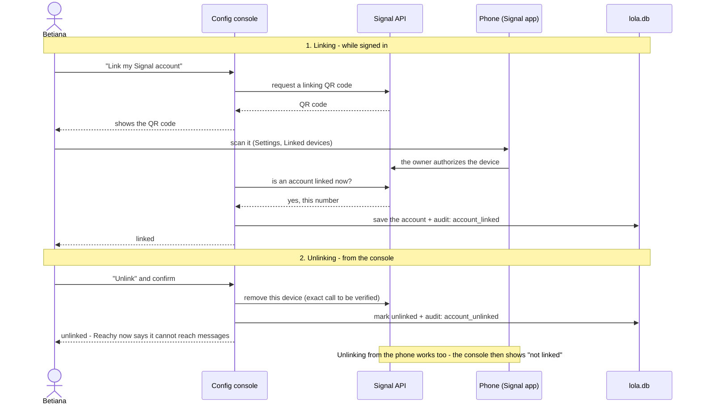
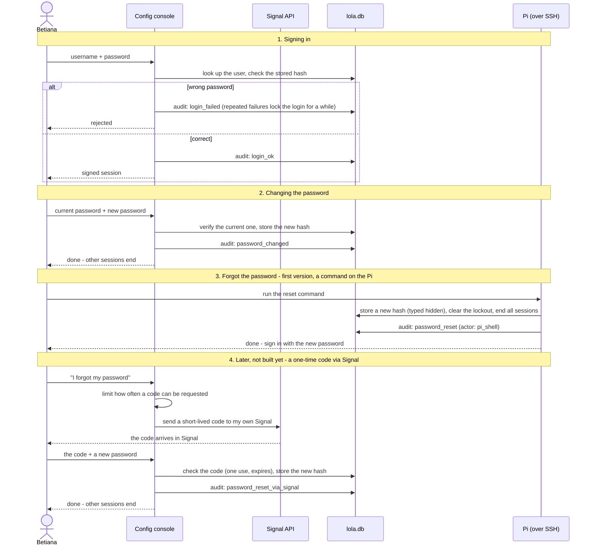
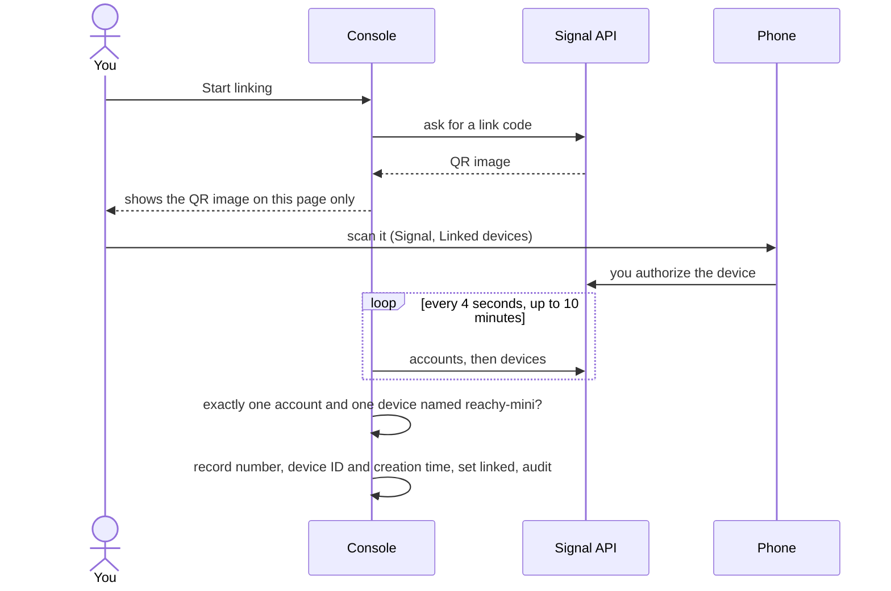

# Config console (Story 3)

- Own process and port, LAN only, one user per account.
- **Login**: credentials, one user. Keycloak maybe later.
- **Pages**: link Signal, manage groups, view logs.
- **Audit**: every action is written to `audit_log`.
- Reads and changes `lola.db`, the same database the conversation app uses. See [data-model.md](data-model.md).
- Talks to the Signal API, which listens on the Pi only.

## Linking and unlinking Signal

## Login, password change and recovery

Recovery: a reset command on the Pi for now; a one-time code via Signal later (not built yet).

## As built (updated 2026-11-04)

This section is newer than the ones above. Where they differ (for example the unlink flow), this one wins; the older sections are reconciled in the next docs pass.

### Pages and commands

| Where | What |
|---|---|
| `/login`, `/logout` | Sign in and out. Events are audited as `console:<username>` or `console:anonymous`; the typed username is never stored |
| `/` | Home: counts and links |
| `/password` | Change password: current password, then the new one twice |
| `/signal` | Signal account: status and linking (unlinking comes in step 8b) |
| `manage.py create-user`, `reset-password`, `status`, `make-cert` | Run on the Pi |
| `run.py` | Starts the console over HTTPS on port 9443 (`LOLA_CONSOLE_PORT`) |

### Security as built

- HTTPS only, with a self-signed certificate valid for `reachy-mini.local`, localhost and the Pi's addresses. The key stays in `~/.config/lola-bla/tls`, outside the repo.
- Passwords: scrypt hashes. The minimum is 5 characters on purpose; the username may not appear inside; a few easy guesses are refused.
- Lockout: 5 wrong passwords in a row lock sign-in for 15 minutes. Wrong current passwords on the change-password page count too. A reset on the Pi clears it.
- Sessions: signed cookies (HttpOnly, Secure, SameSite=Strict), 8 hours. Every request re-checks the database, and a password change ends every earlier session.
- Forms: a CSRF token and an Origin check on every POST. `Referrer-Policy: same-origin`, because `no-referrer` makes browsers send `Origin: null` and would lock everyone out. No HSTS, because it would stop the browser accepting the self-signed certificate.
- The console answers only to its own host names, and pages are never cached.

### Signal page (step 8a)

The status comes from the Signal API's own answers (`/v1/accounts` and `/v1/devices/<number>`), never from the database alone. The number is shown masked, and loading the page never changes data. If the Signal API is busy (it does one operation at a time, for example during a long receive), the page can take up to a minute and may say "Cannot tell".

| State | Meaning |
|---|---|
| Linked | Our number is registered and our recorded device (ID and creation time) is on its device list |
| Not linked | The API has no account, or says the number is not registered. Linking is offered only when the API has no account at all |
| Removed from Signal | The number is registered but our device is no longer on its list (removed in Signal on the phone) |
| A different account | The API has an account that is not the one in the database |
| Cannot tell | The API did not answer, or answered something unexpected |

A different account than the one in the database is refused: nothing is recorded, and the page says to remove the new device in Signal on the phone.
