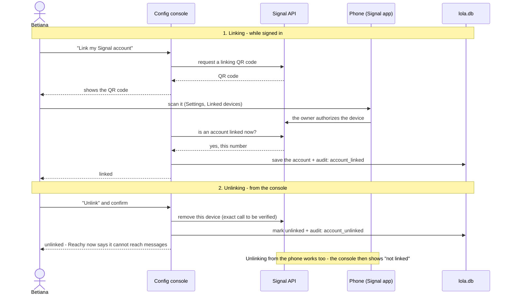
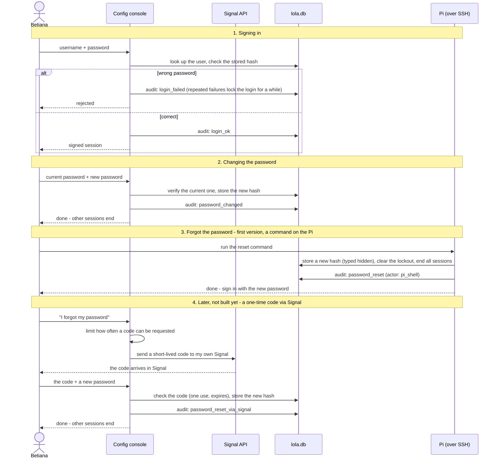

# Config console (Story 3)

- Own process and port, LAN only, one user per account.
- **Login**: credentials, one user. Keycloak maybe later.
- **Pages**: link Signal, manage groups, view logs.
- **Audit**: every action is written to `audit_log`.
- Reads and changes `lola.db`, the same database the conversation app uses. See [data-model.md](data-model.md).
- Talks to the Signal API, which listens on the Pi only.

## Linking and unlinking Signal

## Login, password change and recovery

Recovery: a reset command on the Pi for now; a one-time code via Signal later (not built yet).

