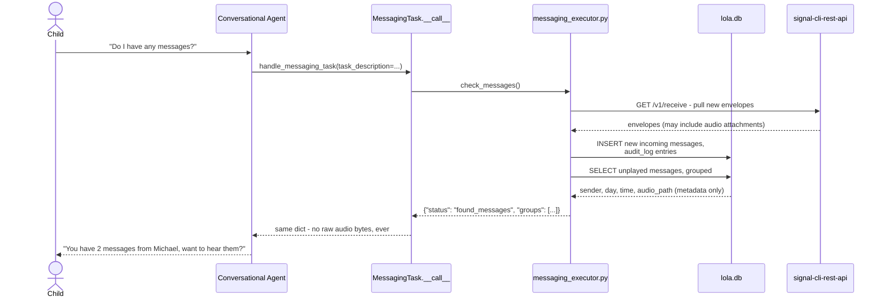
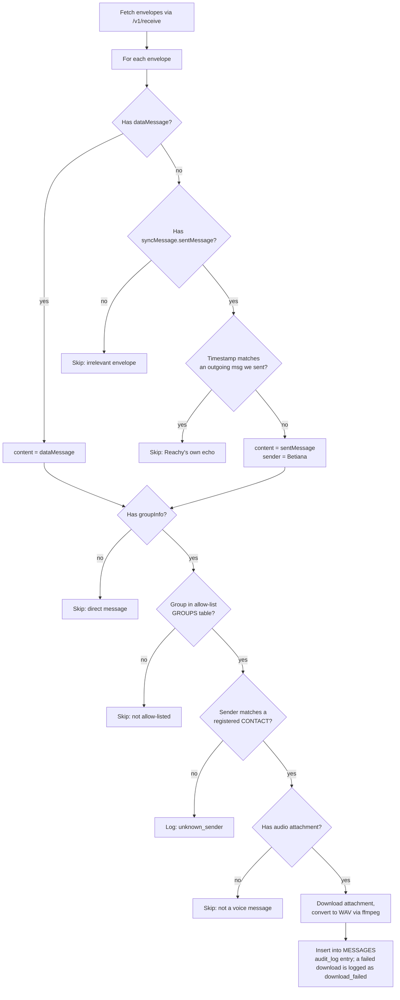
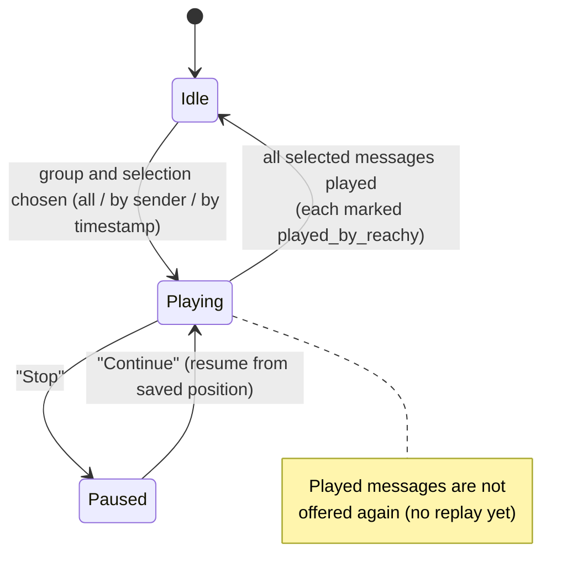
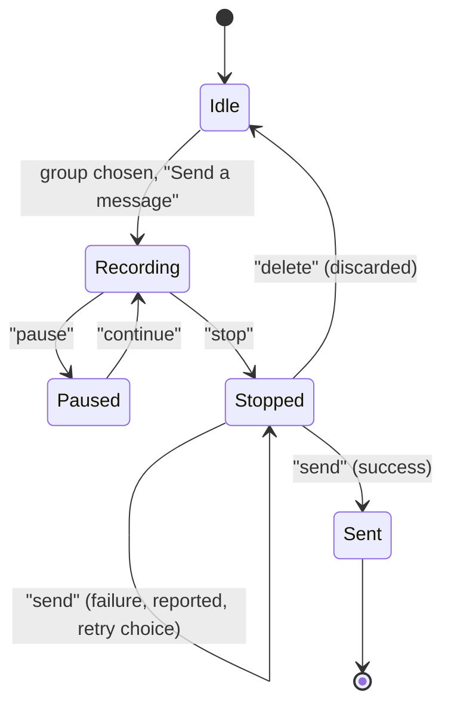
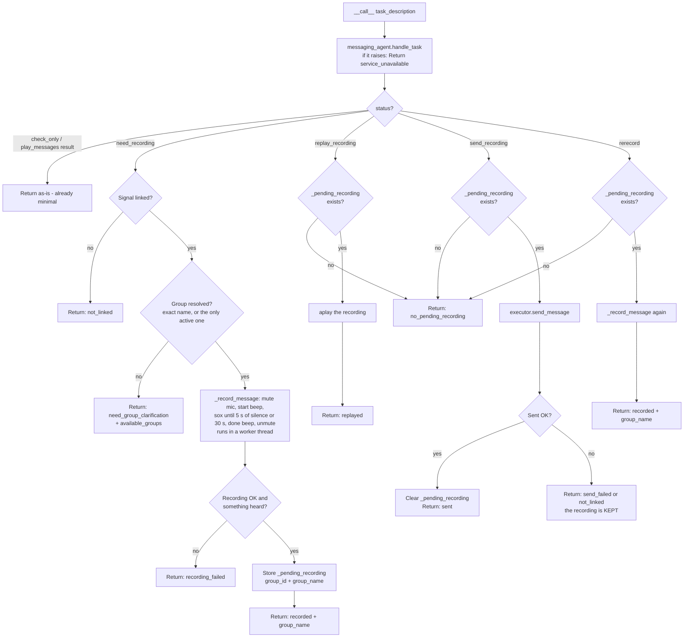
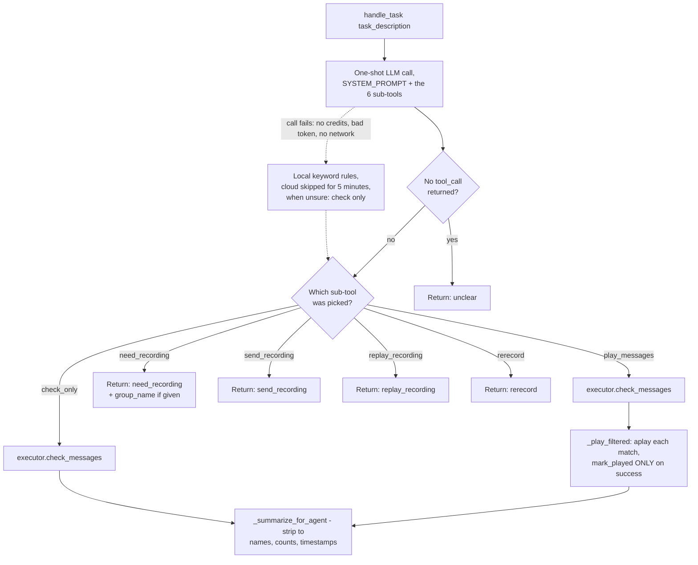
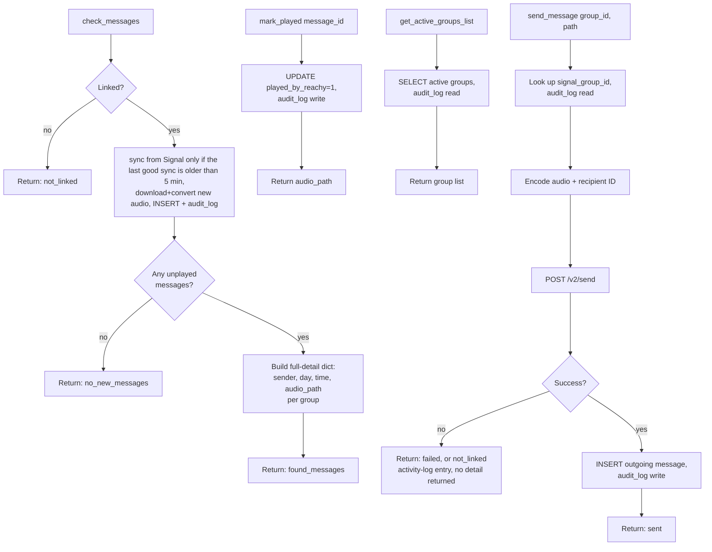
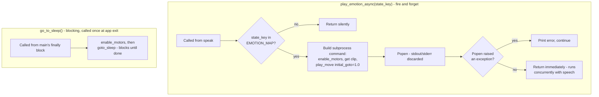
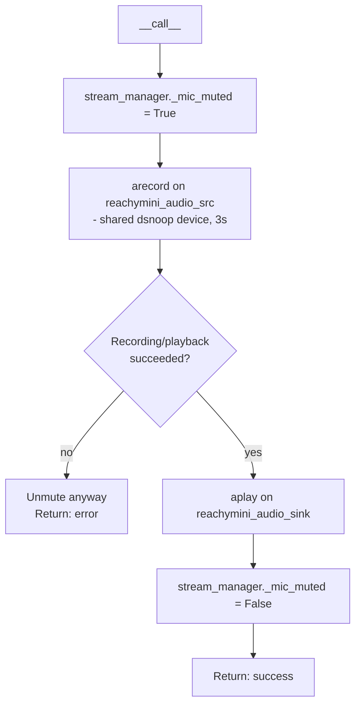

# Conversation app

The voice part running on Reachy. Overall design: [architecture.md](overview.md).

## Check messages

### Syncing from Signal (`_sync_messages` in `messaging_executor.py`)

A background thread inside the app runs this every 2 minutes. `check_messages` syncs by itself only if the last good sync is older than 5 minutes.

## States

### Playback

### Recording and sending a reply

## Modules

### `handle_messaging_task.py` (`MessagingTask.__call__`)

### `messaging_agent.py` (`handle_task`)

### `messaging_executor.py`

### `emotions.py`

### `test_mic_handoff.py`

Test tool that proved the mic handoff works.

