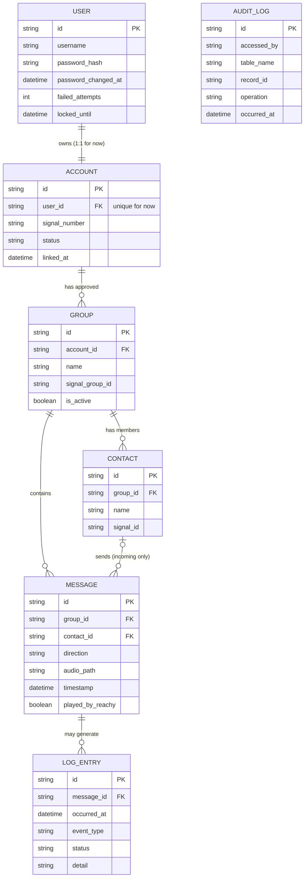

# Data model

All data lives in `lola.db` (SQLite), shared by the conversation app and the config console.

- **USER**: console login (one user for now).
- **ACCOUNT**: the linked Signal account (1:1 with USER for now).
- **GROUP**: allow-listed Signal groups; only active groups are visible to the app.
- **CONTACT**: registered members of a group.
- **MESSAGE**: incoming and outgoing audio messages (audio stored as a local file).
- **LOG_ENTRY**: activity log per message, including failures (shown in the console).
- **AUDIT_LOG**: every read and write of private data.

## Planned vs. built

This diagram is the target model. The current `schema.sql` (see [database.md](../reference/database.md)) has `groups`, `contacts`, `messages` and `log_entries`. `users`, `accounts` and `audit_log` come with the console.

> Open point: `messages.playback_position_sec` (resume paused playback) exists in `schema.sql` but is missing from this diagram.
