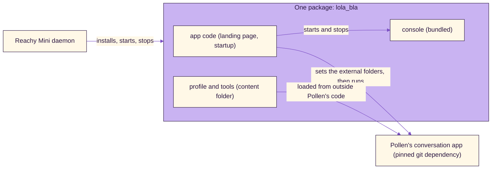

# Installable package (spec)

Status: proposal, 2026-11-07. Nothing here is built yet. It turns the gaps in [publishing.md](publishing.md) into a build order. Facts about Pollen's app come from its published README; the points marked "to verify" must be tried on the robot before building on them.

## Goal

One thing a person installs from Reachy Mini Control's app list, which brings everything Lola-Bla needs, with no commands and no patched copy of anyone's code.

## Today and target

| Today | Target |
|---|---|
| Pollen's app: a git clone pinned to one commit, plus a 24-line patch | A pinned git dependency on Pollen's app. The patch is a separate decision (below) |
| Our tools and Lola's profile are linked into that clone | Kept inside our package and loaded from outside Pollen's code, through the folders Pollen's app supports for external profiles and tools |
| The console is a second package (`lola-console`) that is not published | Bundled in the same package, so there is nothing else to install |
| Data lives inside the clone's `local_data` folder | In its own data folder, chosen by one setting. The robot that runs today keeps its data where it is |
| Set up by `app/install.sh` | The package installs itself. First-run steps (Signal API, linking) start at the console |

## Shape

## Decisions in the proposal

1. **Bundle the console** in the same distribution (both `lola_bla` and `lola_console` packages, with its templates, fonts and static files). No second package to find.
2. **External content.** Before Pollen's code reads its settings, `LolaBla.run()` sets `REACHY_MINI_EXTERNAL_PROFILES_DIRECTORY` and `REACHY_MINI_EXTERNAL_TOOLS_DIRECTORY` to folders inside our package and `AUTOLOAD_EXTERNAL_TOOLS=1`. To verify: that the version installed on the robot (1.0.1) reads these, and that our tools find the messaging modules that today sit in `local_data`.
3. **Data folder.** One setting, `LOLA_DATA`, with a default outside the package, so removing or updating the app never deletes the database, audio or Signal keys. The existing robot sets it to where its data is today.
4. **The space is a separate repository.** The store installs from a Hugging Face Space, not from this repository. A small script assembles the Space from this repository (package, `index.html`, `style.css`, the README tag) and publishes it with Pollen's assistant, so this repository can stay private.
5. **The patch stays parked.** Lola-Bla needs a two-line change in Pollen's app (it lets a tool mute the microphone). Without it, messaging may not work. Options when tackled: ask Pollen to accept it, work around it in `LolaBla.run()` if the object is reachable, or fork. Until then the store version is for the author's robot only.

## Build order (each step is tested on its own)

1. **Assemble:** one distribution with both packages and the content folder. Test: install it into a fresh environment on the robot (not the daemon's), import both packages.
2. **External content:** set the folders in `run()`. Test: Lola's profile is the active one, her tools are found, `sleep_robot` is listed.
3. **Data folder:** `LOLA_DATA` with the safe default. Test: the running robot still uses its current data; a fresh one gets an empty database.
4. **Space script:** build the Space folder and run Pollen's checker, which today reports only the missing `index.html`.
5. **Private release:** publish a private Space, install it from the app list on the robot, start it, stop it.
6. **Removal test:** remove the app, check that the data, the Signal keys and the Signal API are untouched, then install again.
7. **Public release**, after the patch decision and a final privacy re-check.

## Open questions

- Does the store install pip git dependencies for an app? To verify with the private release.
- Does Pollen's app (the version the store brings) read the external folders the same way as the pinned commit?
- Where does the first-run setup of the Signal API container live for a stranger: a guide, or the console?
