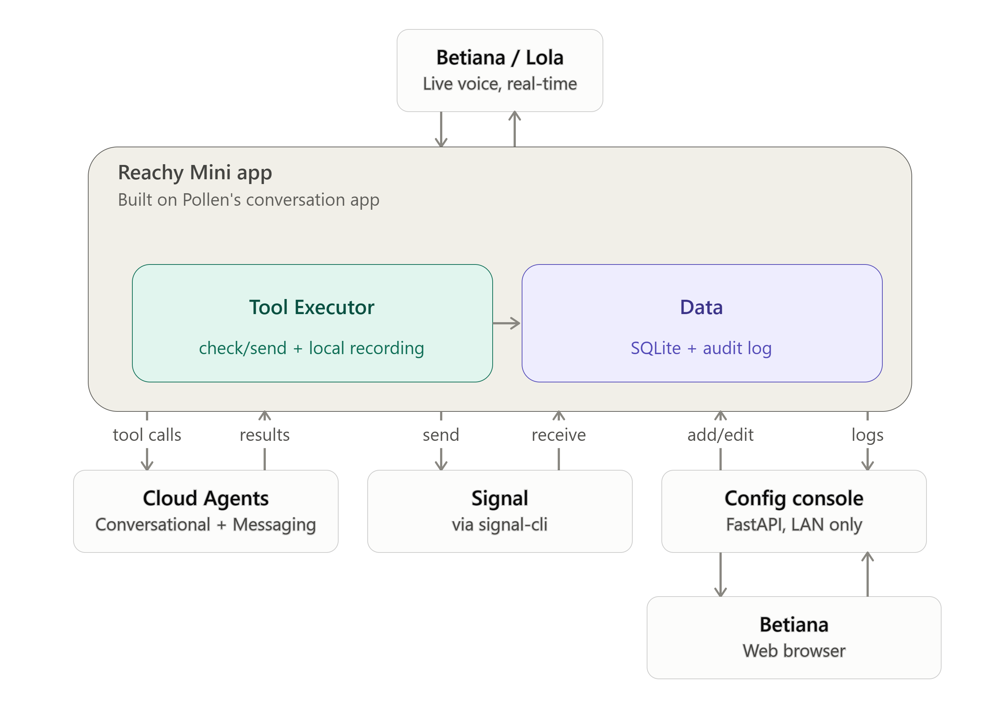
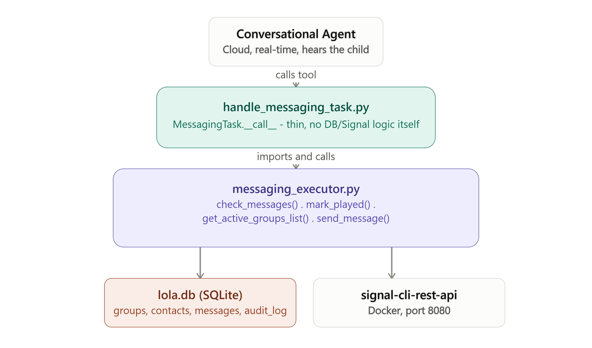
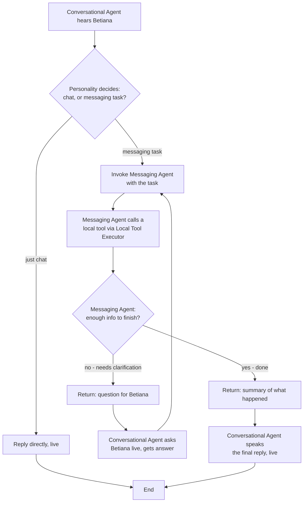
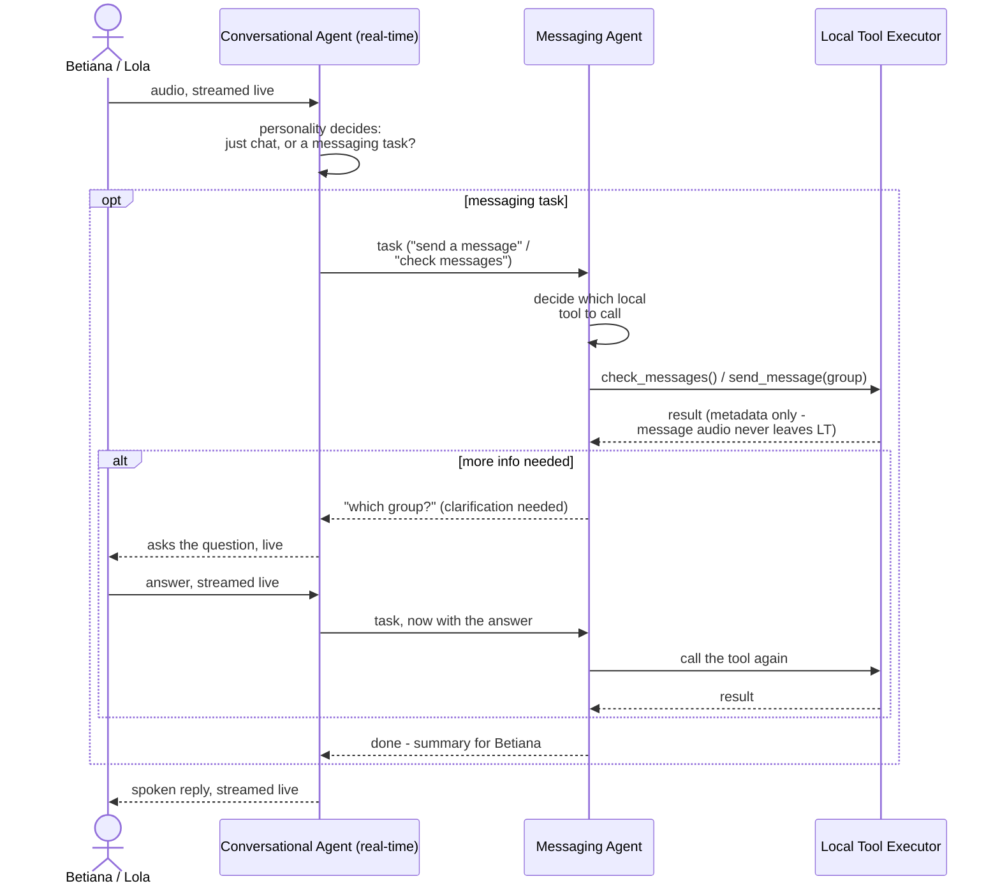
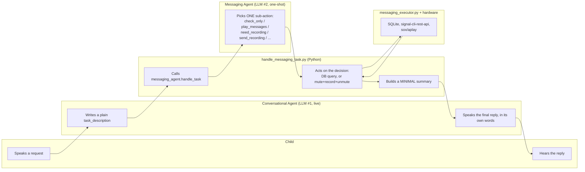
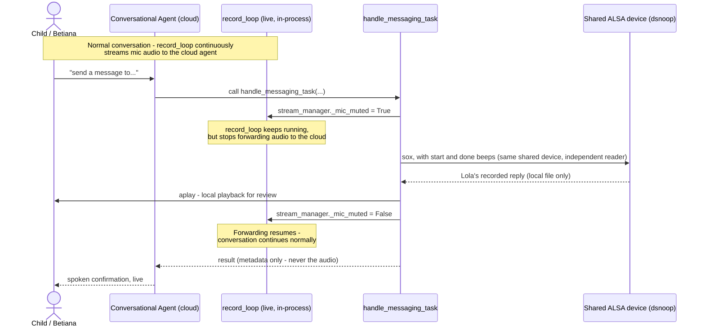

# Architecture

## System overview

Two parts run on the Reachy Mini (Raspberry Pi):

- **Conversation app**: built on Pollen's conversation app. A cloud conversational agent talks live with Betiana or Lola; messaging work happens locally through tools. See [conversation-app.md](conversation-app.md).
- **Config console**: separate process, served over HTTPS on port 9443 and protected by a password. Betiana links Signal, manages groups and reads logs. See [console.md](console.md).

Both share one SQLite database, `lola.db`. See [data-model.md](data-model.md).

| Part | Choice |
|---|---|
| Hardware | Reachy Mini Wireless (Raspberry Pi CM4, 4 GB) |
| Live conversation | Cloud conversational agent: Pollen's conversation app, Hugging Face realtime backend; profile in [`profiles/lola`](../../profiles/lola/profile.md) |
| Messaging decisions | Messaging Agent, one-shot LLM call (`meta-llama/Llama-3.3-70B-Instruct` via Hugging Face Inference API) |
| Signal | `signal-cli-rest-api` in Docker, port 8080, listens on the Pi only |
| Audio | `sox` (recording, stops after about 5 s of silence) and `aplay` on the shared ALSA device (dsnoop) |
| Data | `lola.db` (SQLite, owner-only file permissions) |
| Console | Starlette and uvicorn over HTTPS (port 9443), password sign-in, one user per account |

## Messaging layers

- `handle_messaging_task.py`: the tool the conversational agent calls. Thin, no DB or Signal logic.
- `messaging_agent.py`: picks one sub-action for the task.
- `messaging_executor.py`: talks to `lola.db` and `signal-cli-rest-api`.

## Two-agent orchestration

### Sequence, with the clarification loop

### Who does what

## Mic handoff (mute, not release)

While a reply is recorded, the live stream to the cloud is muted, so the recording stays on the Pi.

## Privacy rules

- Message audio (incoming and recorded replies) never leaves the Pi. Agents only get metadata: names, counts, timestamps.
- Only allow-listed Signal groups and registered contacts are processed.
- Every read and write of private data goes to `audit_log`.
- Signal API listens on the Pi only; the console is reachable on the home network over HTTPS and needs a password.
- The messaging assistant uses its own Hugging Face token (`local_data/hf_token`, owner-only, never committed).

## Decisions

- Built on Pollen's conversation app with a cloud conversational agent. This replaced the first, fully local prototype (`whisper.cpp` + Piper), whose speech recognition took 15–30+ s per turn on the Pi. See the [development plan](../development-plan.md).
- Two agents: the live agent handles the conversation, a one-shot Messaging Agent picks the messaging action.
- Betiana's own Signal account, no separate number for Lola.
- Filtering by allow-listed groups, not individual senders.
- Mic handoff by muting the stream, not releasing the device.
- Reachy's antennas not used for now.
- The Messaging Agent falls back to simple local keyword rules when its cloud call fails (no credits, bad token, no network). When unsure the rules only check; they never play or send. After a failure the cloud is skipped for 5 minutes, and the switch is written to the activity log.
- New messages are pulled into the database by a background sync inside the app every 2 minutes, so "check my messages" reads the database instead of waiting on Signal.
- A failed send keeps the recording, and a recording is kept only if something was heard.
- A group is chosen by its exact name: "Test" never means "Another test". An unknown or ambiguous name plays nothing.
- Console: HTTPS with a self-signed certificate; password login with a deliberately short minimum (5 characters) and a strict lockout (5 tries, 15 minutes); Keycloak later.
- Unlink is a guided action, because only the phone can revoke a linked device.
- Our files inside Pollen's clone are links into this repo (one copy of each). Data and secrets stay outside the repo. Pollen's app is pinned to commit `b9f58a3` plus a two-line patch (`app/patches`).
