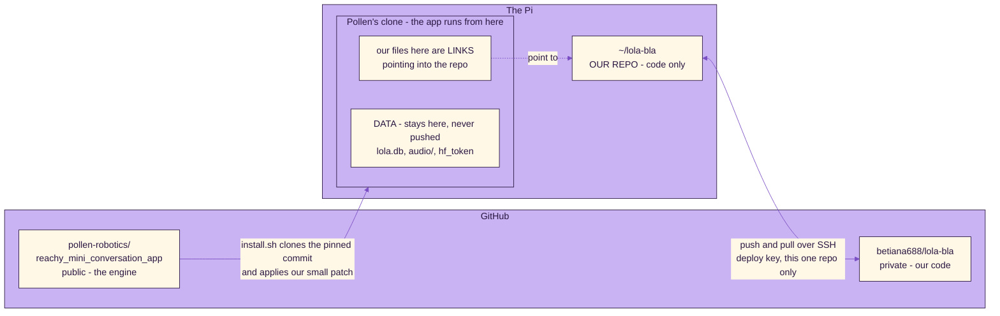

# How the Pi, the repo and GitHub connect

- The app runs from Pollen's clone. Our files there are links to the files in this repo, so there is one copy of each.
- Editing a file edits the repo's file. Then commit and push from the repo folder.
- The database, audio and tokens stay in the clone's local_data folder, outside the repo, so they cannot be committed by accident.
- Pollen's engine comes from its public repo at one pinned commit (app/patches/POLLEN_COMMIT) plus our patch. We never push there.
