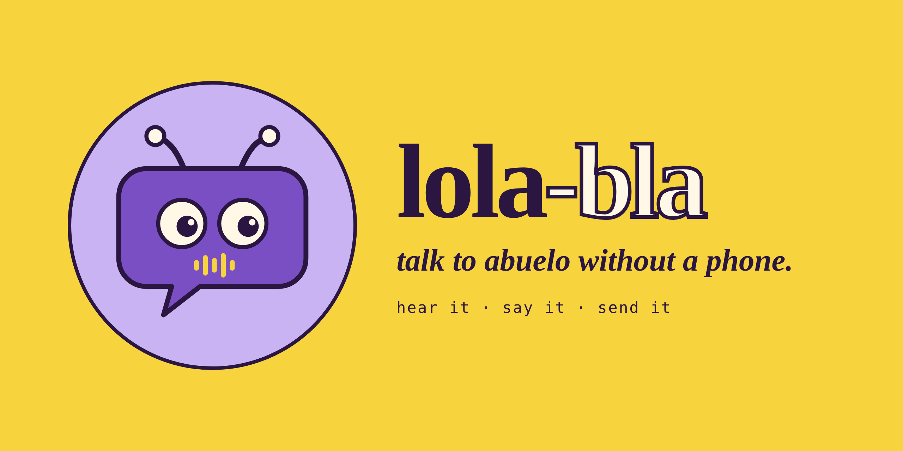

# Lola-Bla brand

**talk to abuelo without a phone.**

## The idea

The mark is a speech bubble that is also a robot face: antennas and big round eyes for the Reachy Mini, and a small yellow sound wave where the mouth would be. It is a messaging app and a character a small child can recognise at the same time.

The look is riso print and indie zine: thick outlines, flat colour, no gradients, no shadows.

## Files

| File | Use |
| --- | --- |
| [lola-bla-mark.svg](lola-bla-mark.svg) | The mark on its own |
| [lola-bla-icon.svg](lola-bla-icon.svg) | App icon (yellow tile) |
| [banner.png](banner.png) | README and social header |
| [poster-lola-bla.png](poster-lola-bla.png) | Main poster |
| [poster-talk-to-abuelo.png](poster-talk-to-abuelo.png) | Story poster |
| [how-it-works.png](how-it-works.png) | Ding, hear it, say it, send it |
| [stickers.png](stickers.png) | Sticker sheet |
| [tokens.css](tokens.css) | Colours, fonts, lines, radii and spacing as CSS variables |
| [fonts/](fonts/) | Fraunces and DM Mono (SIL Open Font License) |

## Colour

| Name | Hex | Use |
| --- | --- | --- |
| banana | `#F7D33E` | Main ground, the sound wave, highlights |
| lila | `#C9B3F2` | Second ground, soft surfaces |
| violeta | `#7B4FC4` | The bubble, accent words, buttons |
| berenjena | `#2A1640` | Every line and all text |
| crema | `#FFF8E7` | Eyes, cards, text on violeta and berenjena |

Text is berenjena on banana, lila or crema, and crema on violeta or berenjena. Never yellow text on lila.

## Type

- **Fraunces Black** (900) for the wordmark and headlines, tight tracking (-0.04em). Fraunces Semibold Italic (600) for one accent word or the tagline.
- **DM Mono** for labels, UI text and small talk, lower case, slightly spaced (0.06–0.08em).

## Shape

- Every shape has a berenjena outline, 5px at screen size.
- Cards have 32px corners; the app icon is a rounded square; stickers are circles, pills or tilted cards (−4° to +5°).
- Separators are a single 3px berenjena rule.

## Voice

Short, warm, lower case, a little playful. Say what Lola does, not how it works: *hear it · say it · send it*. Bilingual is fine: *hola abuela!*

Lines we use: "talk to abuelo without a phone.", "little voice, big world.", "what's said at home, stays home.", "far away, close by".

## Don'ts

- No gradients, glows or drop shadows.
- No more than one accent colour per small element.
- Don't redraw the mark: use the SVG.
