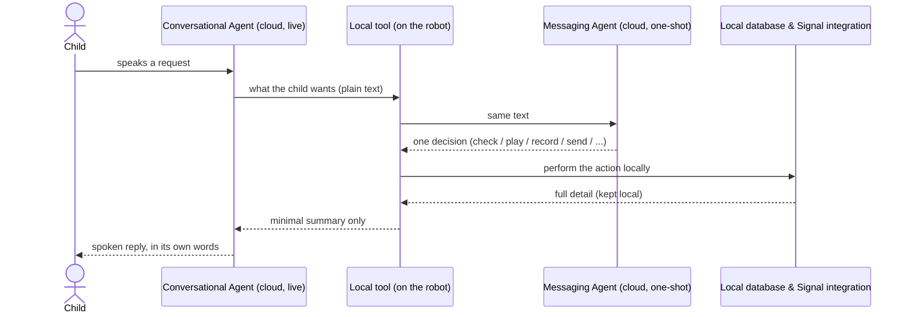
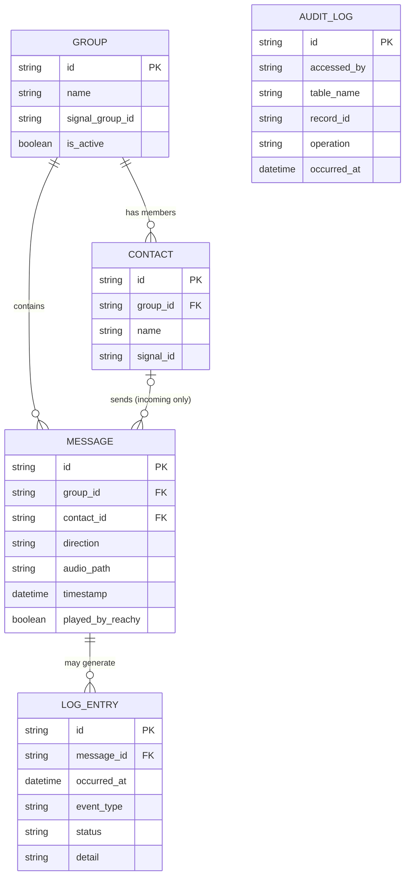

# Lola-Bla — Software Development Plan

## 1. Purpose

A Reachy Mini robot that lets a young child hear and send voice messages to family abroad, safely and independently — without needing a parent's phone every time, and without giving a child open access to a messaging app.

## 2. User Stories & Acceptance Criteria

### Story 1: Reading messages
As Lola, I want Reachy to read out audio messages sent to Signal upon request, because I'm too young to read or write.

- Reachy asks which group to check (or announces directly if only one has new messages)
- "New" is based on whether Reachy has played a message, not Signal's own read state
- Messages play in received order, announcing sender, day, and time
- Playback can be stopped and later continued
- Says so if there's nothing new

### Story 2: Replying to messages
As Lola, I want Reachy to help me reply to messages and send them to the right group, because I'm too young to read or write.

- Reachy asks which group to send to
- Recording, then a choice: replay, send, or delete (replay loops back to the same choice)
- Confirms the group before sending
- Reports failure if sending fails, never silently

### Story 3: Configuring the app
As the parent, I want to configure the app, to control exactly who can interact with my child.

- Web console to manage allow-listed Signal groups and the contacts within them
- Group membership alone does not authorize a sender — explicit approval required
- Activity log with failures visible, console restricted to the parent
- **Status: not yet built** — managed manually in the interim.

### Story 4: Performance, security, and privacy
As the parent, I want the app to be performant, secure, and privacy-respecting, because this is a family app for a child.

- **Performance & personality:** response begins within 2s (target) / 4s (ceiling); varied, warm, age-appropriate phrasing; content-safety redirect to parents for anything out of scope
- **Security:** only the parent can access sensitive data, wherever it's stored or processed; third-party services see only the minimum needed
- **Privacy:** no third-party service retains or trains on sensitive data; an audit trail records access to sensitive data, itself restricted to the parent

## 3. How the build actually happened, step by step

### Phase 1 — Local prototype (Stories 1 & 2)

Built a fully self-contained, rule-based version first, to validate the core idea before investing in anything more complex.

1. Signal integration via `signal-cli-rest-api` in Docker, linked as a secondary device
2. SQLite schema — groups, contacts, messages, logs
3. Local speech recognition (`whisper.cpp`) and speech synthesis (`Piper`)
4. A hand-written dialogue manager: group-first message checking, "new for Reachy" tracking independent of Signal's own read state, day/time announcements, pause/continue
5. A full record → replay/send/delete flow for outgoing messages
6. Expressive robot reactions (a curated emotion library) tied to conversation state
7. Wake/sleep behavior bookending every session

**What this phase revealed:** the logic worked end to end, but local speech recognition on the Pi's CPU took 15-30+ seconds per interaction — far too slow for anything resembling natural conversation, and no further local optimization could close that gap without sacrificing accuracy too. This directly motivated Story 4 and a different architecture.

### Phase 2 — Rebuilding around real-time, cloud-assisted conversation

Rather than patch around the local performance ceiling, the app was rebuilt on a genuinely different architecture, while keeping the original local database and Signal integration approach.

1. Adopted Pollen Robotics' open-source real-time conversation app as the foundation, rather than building the audio pipeline from scratch
2. Verified its default behavior worked before customizing anything
3. Investigated its actual tool-extension mechanism directly from source code, rather than assuming
4. Designed and iterated on a dedicated child-safe personality: warm tone, content-safety rules, a parent-redirect rule for anything out of scope, a matched voice, and a greeting in the family's own language
5. Built a "Local Tool Executor" — the only code allowed to touch the database or send/receive Signal messages — reusing the proven logic from Phase 1
6. Built a second, internal AI agent whose only job is interpreting what the person is actually asking for (checking vs. playing vs. recording vs. sending) and deciding the right action — deliberately separated from the live conversation, as a genuine two-agent design
7. Solved a real architectural problem: recording a reply requires the microphone, but the live conversation is continuously using it. Solved by muting the conversation's own audio forwarding (not disconnecting hardware) during a recording, using an audio setup that already supported multiple simultaneous listeners
8. Closed a real intent-recognition gap where "check my messages" and "play my messages" were being treated as the same action, causing messages to be silently played and consumed when only a status check was asked for
9. Added: a clear audio cue when recording starts, automatic stop after a few seconds of silence (rather than a fixed duration), and a distinct cue when recording ends
10. Built in an audit trail from the start, rather than retrofitting one later — every access to sensitive data is logged
11. Reviewed and tightened file-level access control (previously default-permissive) rather than assuming the architecture alone was sufficient
12. Verified real conversation latency throughout — consistently well within target, a direct validation of the architectural change

### Phase 3 — Reliability, the repo and the console (28 October to 4 November 2026)

1. Closed the Signal API to the network (it listens on the Pi only) and moved the Signal account into the database (`users`, `accounts`), with a backup and a migration.
2. Made "not linked" a normal state: the app detects it, says so kindly, never records a message it cannot send, and a failed send keeps the recording. A recording is kept only if something was heard.
3. Fixed a dropped live connection during long tool calls (blocking work moved to worker threads).
4. Gave the messaging assistant its own token, and added a local keyword fallback for when its cloud call fails (no credits, expired token).
5. Added a background sync every 2 minutes: a check dropped from about 7.5 seconds to under a second.
6. Put everything in one repo: our files inside Pollen's clone are links into it, Pollen's app is pinned to the commit we run plus a two-line patch, data and secrets stay outside the repo, `app/install.sh` rebuilds a fresh install and `save.sh` scans for secrets before every push.
7. Fixed group matching so "Test" never plays "Another test".
8. Console: the first user from the Pi (step 5); HTTPS sign-in with lockout, signed sessions and CSRF protection (step 6); change password (step 7); the Signal page with linking by QR code (step 8a). Real-browser testing caught a bug the offline tests missed (the Origin check combined with `Referrer-Policy: no-referrer`), and linking was tested against a throwaway Signal API and a copy of the database, never the live ones.
9. Console step 8b: unlinking is a guided action (the robot is marked unlinked first, then unregister, then delete the app's local Signal data), because only the phone can revoke a linked device. An accident during testing (the device removed before the console saw the link) led to a clearer message on the link page: a code works only once. Tested live against a throwaway Signal API in both orders (console first; phone first, then Clean up), including the wrong-password refusal, by the author's report.
10. Console step 9: the Groups page. Groups are added from the list Signal gives (names and member counts only), renamed, deactivated or removed. Removing deletes the group, its contacts, its messages and their audio files after a typed word and the password. A read-only mode for the Signal client (`LOLA_SIGNAL_READONLY=1`) lets a test console read the real group list without being able to change anything.
11. Console step 10: the Contacts page. Approved contacts come from the Signal contact list (people with a phone number only), are shown with a masked number, and can be renamed or removed. Removing deletes their messages and audio. Adding needs no extra password, by the author's choice.

## 4. Architecture

Two agents, kept deliberately separate:

- **Conversational Agent** — the only thing with a live connection to the child; real-time, audio-native, carries the personality
- **Messaging Agent** — invoked internally only, decides intent, never touches hardware or data, never seen by the child

Everything sensitive — the database, the actual message audio, Signal itself — is only ever touched by plain local code, never by either AI agent directly. The cloud only ever receives short conversational text and returns decisions or spoken replies; raw audio content, contact details, and message data never leave the device.

## 5. Data model

Key decisions: Signal's own group identifier is stored in its raw form and converted only when needed for sending, never duplicated; being a member of a Signal group never implies authorization on its own — an explicit contact record is always required; the audit trail is deliberately generic, covering access to any table rather than being tied to one.

## 6. Current status

| Story | Status |
|---|---|
| 1 — Reading messages | ✅ Complete |
| 2 — Sending messages | ✅ Complete |
| 3 — Configuration console | 🔨 In progress: sign-in, change password, Signal linking and unlinking, groups and contacts are built; logs are next |
| 4 — Performance, security, privacy | ✅ Built and tested. Story 4c is only partly verified: the cloud services' data policies were read on 2026-11-04, and nothing published could be found for the live conversation (see the [cloud privacy check](reference/cloud-privacy-check.md)) |

## 7. Backlog

- Configuration console (Story 3): the logs page, then run it as a service
- Robot software version currently one release behind its own SDK
- Recording is capped at a maximum duration rather than being fully open-ended
- The Signal API image is pinned only on this Pi (a local tag); `app/install.sh` does not set it up yet
- Two small local modifications to the third-party conversation engine not yet upstreamed
- Recorded audio sent in its captured format rather than converted to a more universal one first
